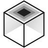
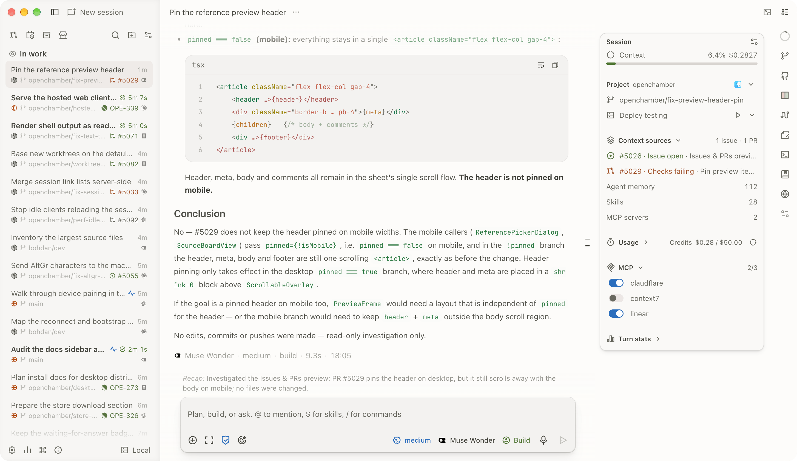
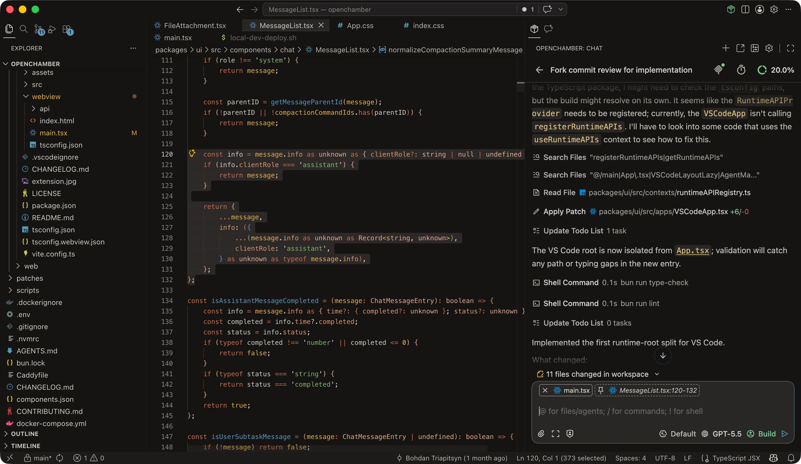
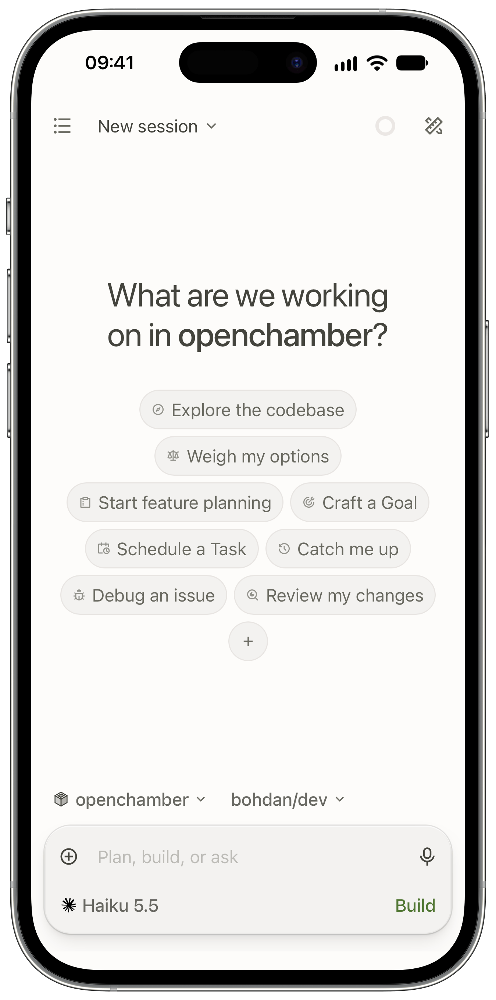
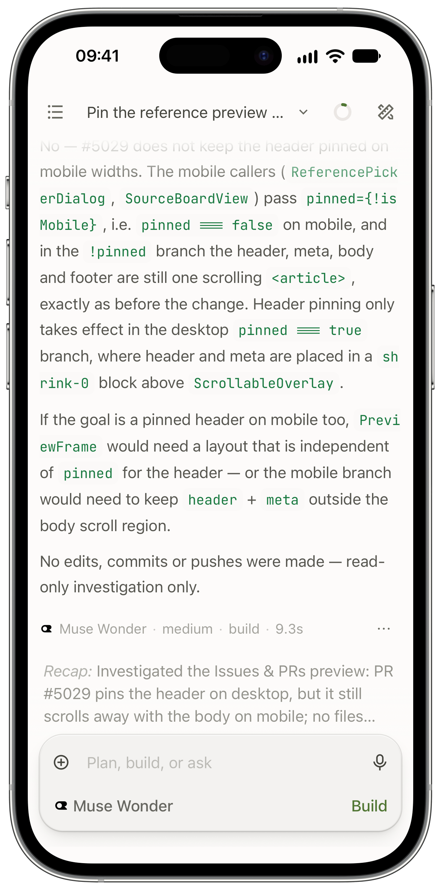
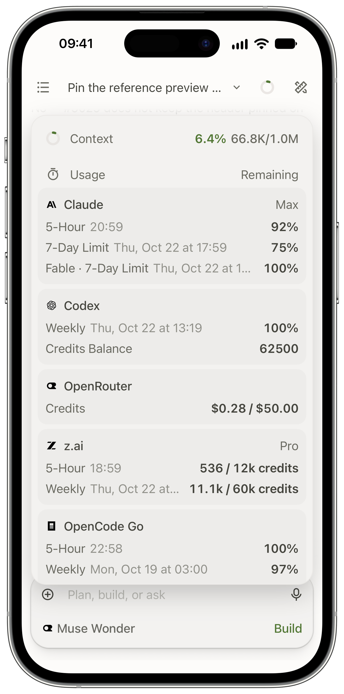

# <picture><source media="(prefers-color-scheme: dark)" srcset="docs/references/badges/openchamber-logo-dark.svg"></picture> OpenChamber A2UI

> [!NOTE]
> **Community / Experimental Fork:** This repository (`AigiasOfficial/OpenChamber_A2UI`) is an independent fork of [openchamber/openchamber](https://github.com/openchamber/openchamber) exploring native [A2UI](https://github.com/a2ui-project/a2ui) interactive visualizations, structured layouts, and multi-question selection forms. It is not affiliated with or endorsed by the upstream OpenChamber or A2UI teams. All upstream copyright and MIT licensing remain intact in [LICENSE](./LICENSE).

[](https://github.com/AigiasOfficial/OpenChamber_A2UI)
[](https://github.com/openchamber/openchamber)
[](https://github.com/a2ui-project/a2ui)
[](./LICENSE)

## What this fork adds: Native A2UI Integration

This fork adds a lightweight, theme-native [A2UI](https://github.com/a2ui-project/a2ui) (`v0.9`/`v0.10`) renderer and on-demand schema architecture to OpenChamber's web & shared UI runtime so agents can render interactive charts, scannable layouts, and large multi-question decision forms without writing brittle custom HTML or bloating every turn's system prompt.

### Highlights

- **Native React A2UI renderer (`packages/ui/src/components/chat/a2ui/`)**: Zero `@a2ui/react`, Lit, or Zod v3 dependencies — built directly on OpenChamber's React 19, Zod v4, and CSS theme variables (`--background`, `--card`, `--chart-1..6`, etc.).
- **25 components with client-side JSON Pointer reactivity**:
  - *Visualizations*: `LineChart` (area mode with headline + delta for single series; interactive multi-line with legend focus/tooltips) and `BarChart` (ranked bars, shares/totals).
  - *Multi-question decision forms*: `QuestionBatch` for 4–50+ structured questions with progress bar, `All / Unanswered / Answered` filters, responsive 2-column grids, expandable local `Details` rationale (0 extra LLM turns), per-question notes, *"Apply recommended"*, and single-turn compact submission.
  - *Layout & controls*: `Column`, `Row`, `Card`, `List` (static & data-bound templates), `Tabs`, `Modal`, `Details`, `Divider`, `Text` (Markdown), `Badge`, `Callout`, `KeyValue`, `Table`, `Stat`, `Progress`, `Steps`, `ChoicePicker`, `TextField`, `CheckBox`, `Slider`, `DateTimeInput`, `Button` (`openModal`, `closeModal`, `setData`, and agent `event` dispatch).
- **On-demand schema loading (prompt-cache friendly)**: Replaces the legacy ~1,100-token always-on `UI_BLOCKS_GUIDANCE` with a ~144-token static pointer. Agents load the full or topic-filtered catalog (`"charts" | "forms" | "all"`) on demand via `openchamber_render({ action: "render.schema" })` as a regular tool result without invalidating prefix prompt caches.
- **Two delivery modes + resilient parsing**:
  - Inline ```` ```a2ui ```` fenced blocks directly in assistant replies (hoisted out of collapsed Activity).
  - `openchamber_render` with `a2ui` (accepts native JSON arrays, shorthand objects, or JSONL strings) plus `awaitAnswer` / `answerLater` for blocking or deferred user decisions.
  - Deterministic parser recovery for common LLM JSON slips (missing/extra trailing delimiters, trailing commas, merged multi-key envelopes, stray component objects).
- **Built-in interactive demo harness**: Open `http://127.0.0.1:3001/?a2ui-demo=1` to test a 30-question batch form, native charts, reactive forms/modals, streaming simulation, and payload inspection locally.

### Running the Web App from Source (this fork)

Requires [Bun](https://bun.sh) `1.4.5+` and Node.js `24.14+`:

```bash
git clone https://github.com/AigiasOfficial/OpenChamber_A2UI.git
cd OpenChamber_A2UI
bun install
bun run build:web

# Start the local web server (use --foreground on Windows)
bun packages/web/bin/cli.js serve --foreground --port 3001
```

Then open:
- **OpenChamber Web UI**: `http://127.0.0.1:3001`
- **A2UI Demo & Test Harness**: `http://127.0.0.1:3001/?a2ui-demo=1`

For implementation details, see [`packages/ui/src/components/chat/a2ui/DOCUMENTATION.md`](packages/ui/src/components/chat/a2ui/DOCUMENTATION.md).

---

## Upstream OpenChamber

### Run agent work. Keep control. Ship from anywhere.

**OpenChamber is an open-source workspace for running and reviewing AI coding work on desktop, web, VS Code, and mobile.**

Start agent work, see what changed, and take it through review and release. Your projects and sessions remain available when you switch devices or step away.

<picture><source media="(prefers-color-scheme: dark)" srcset="docs/references/desktop_dark.png"></picture>

<details>
<summary>More screenshots</summary>



<p>
<picture><source media="(prefers-color-scheme: dark)" srcset="docs/references/mobile/new_session_dark.png"></picture>
<picture><source media="(prefers-color-scheme: dark)" srcset="docs/references/mobile/chat_dark.png"></picture>
<picture><source media="(prefers-color-scheme: dark)" srcset="docs/references/mobile/context_usage_dark.png"></picture>
</p>

</details>

## What you can do with OpenChamber

### Goals that continue on their own

Give a session a finish line with **Session Goals**. OpenChamber checks the result after every turn and keeps the agent working until it completes the goal, gets blocked, or reaches the limit you set. It can continue after you close the app.

### Compare and combine runs

Use **Multi-run** to give the same task to up to five models, each in its own session and optionally its own worktree. See what each one actually built, choose the best result, or use **Fusion** to combine the strongest parts into a new session.

### Guided changes walkthroughs

**Changes Walkthrough** turns a large diff into an AI-guided tour of the change. It groups related edits into steps, puts them in the order the change makes sense, and explains how the pieces fit together.

### Inspect a running app

Open your app beside the conversation with **Preview**. Point at an element to send the agent its screenshot, styles, position, and browser errors. No more trying to explain "this thing here." The desktop app can do the same with any web page in its built-in browser.

### GitHub context from issue to pull request

Start a session from a GitHub issue or pull request with its context attached. Send failed checks or review comments back to the agent, then update or merge the pull request from OpenChamber.

### Continue on another device

Open the same projects and sessions from Desktop, Web/PWA, VS Code, iOS, or Android. Check progress, answer questions, review changes, and reattach to a running terminal.

### Private remote access

Pair a device with a one-time QR code and connect through **Private Relay** without opening ports or exposing a public server. The connection is end-to-end encrypted and can be revoked at any time. Direct connections, LAN/VPN access, Cloudflare/Ngrok tunnels, and SSH are also supported.

### Track work across projects

See which sessions are working, waiting, finished, or failed, along with approvals, scheduled tasks, provider limits, token use, and costs. Organize sessions into folders and keep notes, todos, and reusable project actions nearby.

### Schedule recurring work

Run a prompt once, daily, weekly, or on a cron schedule. Scheduled tasks can use Session Goals, so they continue toward an outcome instead of stopping after one response.

## Use it where you work

| Surface | Role |
| --- | --- |
| **Desktop** | The complete workspace for macOS, Windows, and Linux, with multiple windows, Mini Chat, remote machines, SSH, and native notifications |
| **Web / PWA** | Open your workspace in a browser, install it as an app, and stay up to date through background notifications |
| **VS Code** | Keep sessions beside your code, send selections to the agent, open results in the editor, and compare parallel runs |
| **iOS / Android** | Review and steer work away from your desk, receive completion alerts, and use the terminal with touch controls |
| **CLI / Server** | Run OpenChamber on a workstation or server, schedule work, manage remote access, and keep it available after login |

## Quick start

### Desktop for macOS, Windows, and Linux

Download the latest release from [GitHub Releases](https://github.com/openchamber/openchamber/releases/latest). Desktop bundles the matching OpenCode CLI, so no separate OpenCode installation is required.

The nightly build of `main` is in the [Canary release](https://github.com/openchamber/openchamber/releases/tag/canary). Tomorrow's release, available tonight.

Linux releases come for x86_64 and ARM64 as a `.deb` (Debian, Ubuntu), an `.rpm` (Fedora, openSUSE) and an AppImage. The packages install OpenChamber into the app menu, and in-app updates ask for your password to install the new package:

```bash
sudo apt install ./OpenChamber-*-linux-amd64.deb    # Debian, Ubuntu
sudo dnf install ./OpenChamber-*-linux-x86_64.rpm   # Fedora
```

The AppImage needs no install. Make it executable and keep it in a writable location for in-app updates; on its first start it adds itself to the app menu:

```bash
chmod +x OpenChamber-*.AppImage
./OpenChamber-*.AppImage
```

Linux AppImages require FUSE (`libfuse.so.2`). Without FUSE, run with `APPIMAGE_EXTRACT_AND_RUN=1`.

### VS Code

Install [OpenChamber from the Visual Studio Marketplace](https://marketplace.visualstudio.com/items?itemName=fedaykindev.openchamber), or search for "OpenChamber" in Extensions.

### iOS and Android

Join the iOS beta on [TestFlight](https://testflight.apple.com/join/5ek6GU1E). For Android, download the `.apk` from the [Canary release](https://github.com/openchamber/openchamber/releases/tag/canary).

### CLI for Web and PWA

Requires Node.js 24.14+. CLI/Web bundles the matching OpenCode server (no separate OpenCode installation required). VS Code uses your installed [OpenCode CLI](https://opencode.ai).

```bash
curl -fsSL https://raw.githubusercontent.com/openchamber/openchamber/main/scripts/install.sh | bash
openchamber --ui-password be-creative-here
```

Common operations:

```bash
openchamber status
openchamber connect-url --qr
openchamber tunnel start --provider cloudflare --mode quick --qr
openchamber startup enable
openchamber logs
openchamber stop
openchamber update
```

OpenChamber binds to localhost by default. Use `--lan` only on a trusted network and protect browser access with `--ui-password`.

### Docker

Each release publishes `ghcr.io/openchamber/openchamber` for Linux x86_64 and ARM64, with OpenCode included. The container listens beyond itself, so it needs a UI password:

```bash
docker run -d --name openchamber -p 127.0.0.1:3000:3000 \
  -e OPENCHAMBER_UI_PASSWORD=be-creative-here \
  -v openchamber-config:/home/openchamber/.config \
  -v openchamber-data:/home/openchamber/.local \
  -v openchamber-ssh:/home/openchamber/.ssh \
  -v openchamber-workspaces:/home/openchamber/workspaces \
  ghcr.io/openchamber/openchamber:latest
```

Open `http://localhost:3000`. The volumes keep settings, sessions, the SSH key and your projects when you replace the container. To pin a release, use its version as the tag, for example `:2.8.0`.

## Guides

Go deeper with the OpenChamber guides:

- [Quick start](packages/docs/content/docs/quickstart.mdx)
- [Installation](packages/docs/content/docs/install.mdx)
- [Connect devices](packages/docs/content/docs/connect-devices.mdx)
- [Private Relay](packages/docs/content/docs/private-relay.mdx)
- [Multi-run](packages/docs/content/docs/multi-run.mdx)
- [Session Goals](packages/docs/content/docs/session-goals.mdx)
- [Changes Walkthrough](packages/docs/content/docs/walkthrough.mdx)
- [Preview and dev servers](packages/docs/content/docs/preview.mdx)
- [GitHub workflows](packages/docs/content/docs/github.mdx)
- [Mobile](packages/docs/content/docs/mobile.mdx)
- [Security](packages/docs/content/docs/security.mdx)
- [Troubleshooting](packages/docs/content/docs/troubleshooting.mdx)

For self-hosting details, see the [reverse proxy guide](docs/REVERSE_PROXY.md). For custom theme authoring, see the [custom themes guide](docs/CUSTOM_THEMES.md).

## Why OpenCode?

OpenChamber uses [OpenCode](https://opencode.ai) to run coding agents. We chose it because it is open source, has a solid API, and is easy to extend.

OpenChamber handles the rest of the workflow. You can decide what to try, keep the agent on track, review the result, connect from another device, and ship the change.

OpenChamber is an independent project and is not affiliated with the OpenCode team.

## Contributing

Bug fixes are welcome as PRs that link their bug report. Features and behavior changes start as a [feature request](https://github.com/openchamber/openchamber/issues/new?template=feature_request.yml), and building starts once it is marked `accepted`. Read [CONTRIBUTING.md](./CONTRIBUTING.md) before opening a PR; it has the setup, the review contract, and what happens to a PR without a linked issue. Documentation authoring guidance lives in [`packages/docs`](packages/docs/README.md).

Bugs go to [issues](https://github.com/openchamber/openchamber/issues/new/choose). Questions go to [Q&A discussions](https://github.com/openchamber/openchamber/discussions/categories/q-a).

## Acknowledgments

Special thanks to:

- [OpenChamber](https://github.com/openchamber/openchamber) and Bohdan Triapitsyn for creating the upstream workspace this fork builds on
- [A2UI](https://github.com/a2ui-project/a2ui) for the open Agent-to-User Interface protocol specification
- [OpenCode](https://opencode.ai) for the API and open-source architecture OpenChamber builds on
- [Pierre](https://pierrejs-docs.vercel.app/) for the diff viewer and syntax highlighting
- The [T3 Code](https://github.com/pingdotgg/t3code) team for their browser adapter for [libghostty-vt](https://github.com/ghostty-org/ghostty), which our terminal is built on
- [Yulia Ivashko](https://github.com/yulia-ivashko), who built the firework celebration that plays on every successful push
- Everyone who contributed code, reported bugs, or shared ideas

## License

MIT
